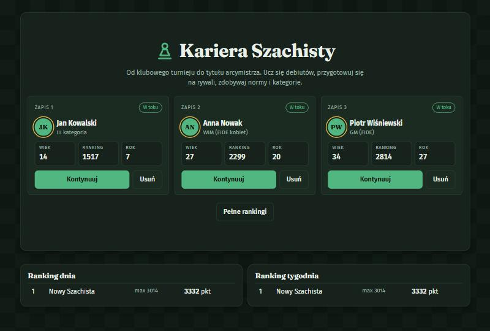
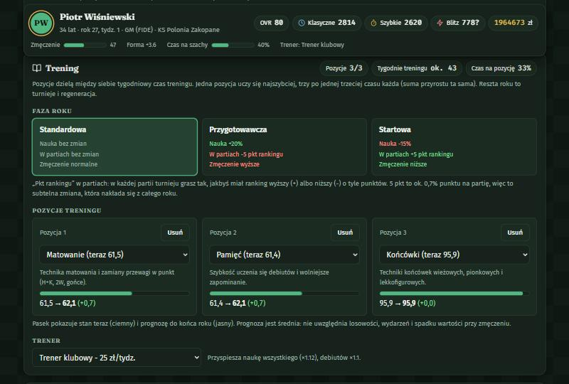
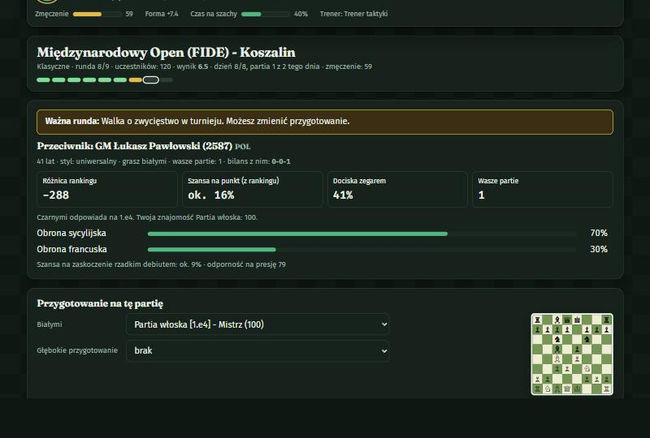
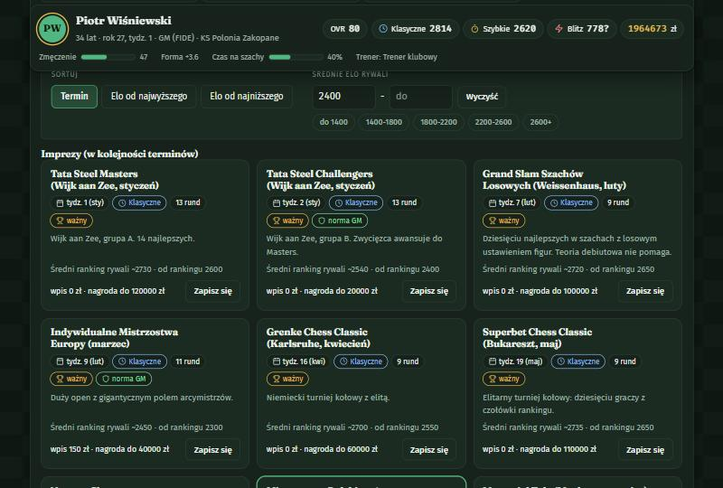
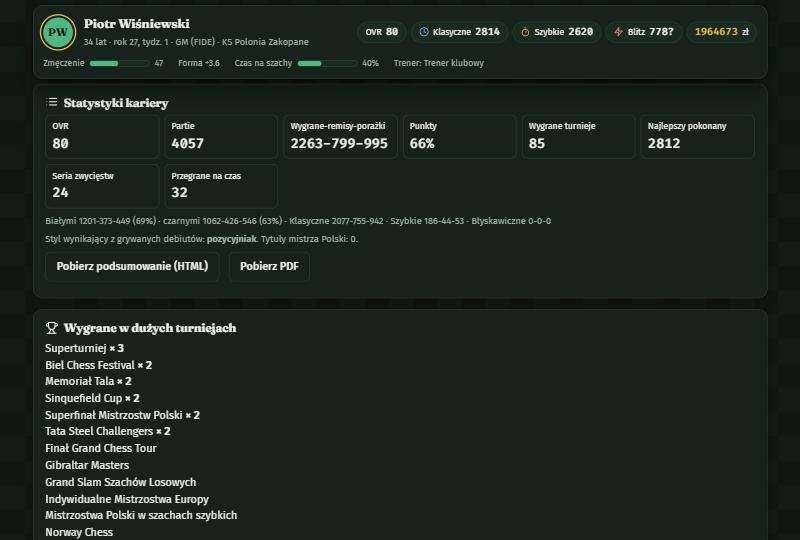
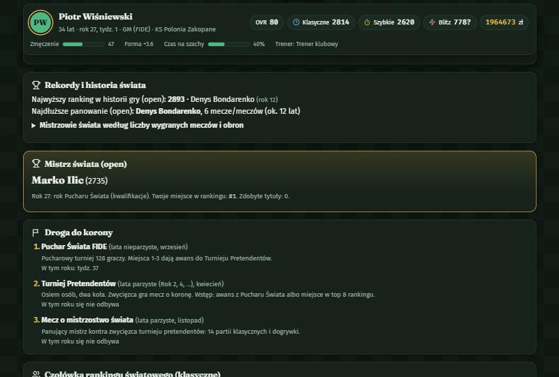
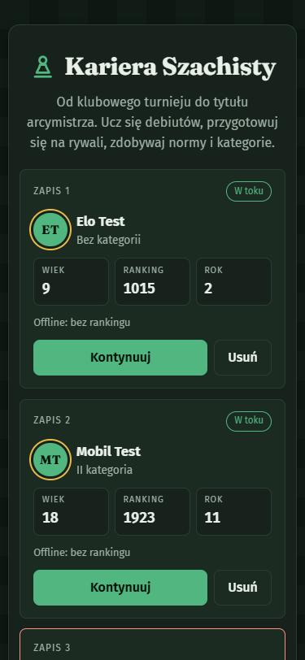
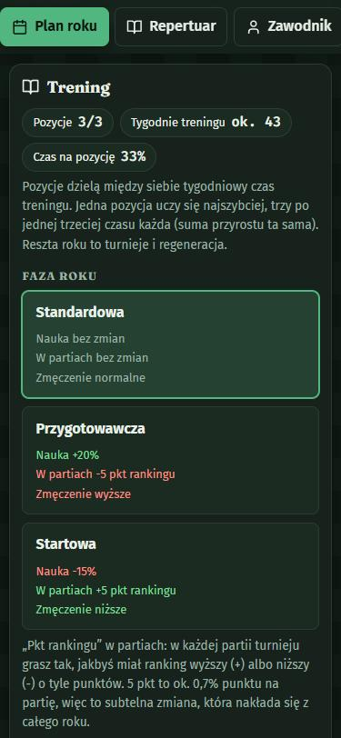
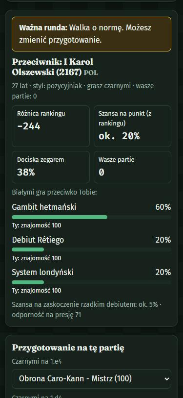
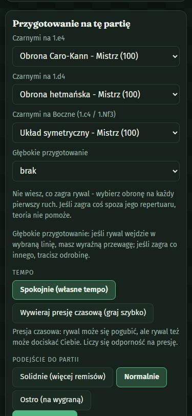

# Symulator Szachisty

**Kariera Szachisty** to polska gra przeglądarkowa o karierze szachowej: od pierwszych turniejów w wieku 8 lat do tytułu arcymistrza i mistrzostwa świata. Nie grasz ruchów, tylko zarządzasz karierą: trenujesz, uczysz się debiutów, wybierasz turnieje, przygotowujesz się na konkretnych rywali, a wyniki partii wylicza symulacja oparta na Twoich statystykach.

Debiuty są kartami: im częściej je grasz i trenujesz, tym lepiej je znasz. Rywale mają własne repertuary i czasem zaskoczą czymś spoza nich, wtedy liczy się siła gry, a nie teoria.

| Ekran główny | Plan roku: trening | Karta rywala |
| :---: | :---: | :---: |
|  |  |  |

## Spis treści

- [Szybki start](#szybki-start)
- [Instrukcja obsługi](#instrukcja-obsługi)
- [Gra na telefonie](#gra-na-telefonie)
- [Zasady gry w skrócie](#zasady-gry-w-skrócie)
- [Informacje prawne](#informacje-prawne)
- [Dla programistów](#dla-programistów)
- [Rozwiązywanie problemów](#rozwiązywanie-problemów)
- [Historia zmian](CHANGELOG.md)

## Szybki start

Wymagania: [Node.js](https://nodejs.org) 20 lub nowszy.

```bash
npm install
npm run dev:all
```

Potem otwórz **http://localhost:5173**. Polecenie `dev:all` uruchamia jednocześnie serwer API (port 8787) i grę (port 5173). Możesz też uruchomić je osobno w dwóch terminalach:

```bash
npm run dev:api   # serwer rankingów i weryfikacji, port 8787
npm run dev       # gra, port 5173 (proxy do API)
```

Bez API gra działa w trybie **offline**: wszystko jest dostępne, ale wynik kariery nie trafi do rankingu. Zapisy trzymane są w przeglądarce (localStorage), w trzech slotach.

## Instrukcja obsługi

### 1. Ekran główny i sloty zapisu

Masz trzy sloty. Każdy pokazuje postać, wiek, ranking i rok kariery oraz status (W toku / Zakończona). Puste miejsce zakłada nową karierę, „Kontynuuj" wczytuje grę, a „Usuń" kasuje zapis na stałe. Poniżej widać rankingi dnia i tygodnia (najlepsze zakończone kariery), a „Pełne rankingi" otwiera wszystkie trzy zestawienia.

### 2. Nowa kariera

Wybierasz imię i nazwisko, płeć (kobiety mają własne turnieje, progi kategorii i tytuły WCM–WGM), miasto, styl (uniwersalny, taktyk, pozycyjniak), pierwszy debiut białymi i **punkt startowy**. Punkt startowy zmienia warunki początkowe i mnożnik wyniku w rankingu: cudowne dziecko (×0,6) ma łatwiej, ale jego wynik liczy się słabiej, a „Pod górkę" (×1,6) trudniej, za to punktuje wyżej.

### 3. Plan roku

Czas płynie rok po roku. Na początku roku układasz plan:

- **Faza roku:** Standardowa, Przygotowawcza (więcej nauki, ale zmęczenie i −5 pkt rankingu w partiach) albo Startowa (mniej nauki, ale +5 pkt rankingu w partiach i mniej zmęczenia).
- **Trening (do 3 pozycji):** umiejętności (taktyka, strategia, końcówki, matowanie, kalkulacja, presja czasu i nerwy, pamięć, kondycja), nauka konkretnego debiutu albo analiza własnych porażek. Pozycje dzielą między siebie tygodniowy czas. Pasek przy każdej pokazuje stan teraz i prognozę do końca roku.
- **Trener:** przyspiesza naukę, kosztuje co tydzień.
- **Zespół** (od rankingu 2000): fizjoterapeuta (rzadsze i krótsze dolegliwości), sekundant debiutowy, analityk komputerowy. Płacisz pensje co tydzień.
- **Debiuty na turnieje:** główny debiut białymi, obrony czarnymi na 1.e4, 1.d4 i partie boczne, tempo (spokojnie lub dociskanie zegarem) i podejście (solidnie, normalnie, ostro). W zwykłych rundach grasz tym planem.
- **Kalendarz turniejów:** zapisujesz się na imprezy i ligi. Filtry formatu (klasyczne, szybkie, błyskawiczne), sortowanie po terminie lub średnim elo, zakres średniego elo i gotowe presety (optymalnie pod ranking, pod normy, pod nagrody, tylko ważne). Imprez w tym samym terminie nie da się połączyć.



Gdy plan jest gotowy, klikasz „Rozpocznij rok". Gra przewija tygodnie i zatrzymuje się na turnieju, wydarzeniu i końcu roku.

### 4. Turniej i partie

Zwykłe rundy przewijają się automatycznie, a Ty widzisz wyniki. Gra zatrzymuje się tylko w **ważnych rundach**: decydujących rundach ważnych turniejów, walce o zwycięstwo, walce o normę i meczu o mistrzostwo świata.

W ważnej rundzie widzisz **kartę rywala**: tytuł, ranking, wiek, kraj, styl, bilans waszych partii (po kilku porażkach rywal staje się *nemezis* i przygotowuje się na Ciebie staranniej), różnicę rankingu, szansę na punkt z rankingu i to, jak często dociska zegarem. Przycisk „Przygotowanie do rywala" zużywa punkt skautingu i odkrywa jego repertuar z procentami linii oraz Twoją znajomością każdej odpowiedzi. Potem możesz:

- zmienić debiuty i podejście na tę partię,
- wybrać **głębokie przygotowanie** na jedną linię rywala: jeśli w nią wejdzie, masz wyraźną przewagę, jeśli zagra co innego, tracisz odrobinę.

W drugiej partii dnia (turnieje klasyczne) nie ma czasu na skauting, a zmęczenie jest większe.

### 5. Zakładki

| Zakładka | Co zawiera |
| --- | --- |
| **Plan roku** | trening, faza roku, trener, zespół, kalendarz |
| **Repertuar** | wszystkie debiuty (karty) i Twoja znajomość każdego, plansza z ruchami |
| **Zawodnik** | umiejętności i OVR, styl gry, kategorie i tytuły (polskie i FIDE), rankingi z wykresem, historia turniejów |
| **Statystyki** | bilans białymi i czarnymi, wyniki wg formatu, rekordy, tabela rok po roku, wygrane duże turnieje, wyniki debiutów, rywale z historią |
| **Świat** | Mistrzostwa Polski, rekordy i historia świata, panujący mistrz, droga do korony, czołówka rankingu światowego |
| **Kronika** | dziennik zdarzeń |
| **Osiągnięcia** | lista osiągnięć |

| Statystyki | Świat |
| :---: | :---: |
|  |  |

### 6. Zdrowie i wydarzenia

Między turniejami zdarzają się wydarzenia z wyborem (stypendium, zmiana klubu, obóz, etapy życia: liceum, studia, praca). Czasem dopada Cię **dolegliwość istotna dla szachów**: ból kręgosłupa (szybsze zmęczenie), wzrok i migreny (słabsza kalkulacja i taktyka), nerwy i bezsenność (słabsza odporność na presję) albo choroba (ogólny spadek formy). Poważne dolegliwości blokują turnieje. Możesz się leczyć u specjalisty, czekać albo ignorować ból.

### 7. Koniec kariery i rankingi

Karierę można zakończyć od 20. roku życia („Zakończ karierę") albo kończy się sama. Na ekranie końca kariery:

- wynik **wysyła się automatycznie** do rankingu i jest weryfikowany przez serwer (replay całej kariery z seeda i logu akcji, serwer nie ufa wynikowi klienta),
- jeśli serwer jest niedostępny, pojawia się przycisk „Wyślij ponownie", a przy wyjściu do Menu wynik czeka i jest dosyłany przy następnym uruchomieniu,
- „Pobierz PDF" i „Pobierz podsumowanie kariery (HTML)" zapisują podsumowanie: ranking rok po roku, wygrane duże turnieje z liczbą razy, ulubiony debiut i bilans.

„Menu (usuwa ten zapis)" kasuje zapis zakończonej kariery.

## Gra na telefonie

Strona jest responsywna. Na wąskich ekranach panele układają się w jednej kolumnie, zakładki tworzą przewijany poziomo rząd przyklejony do góry, a tabele przewijają się w bok zamiast poszerzać stronę.

| Ekran główny | Trening | Karta rywala | Przygotowanie |
| :---: | :---: | :---: | :---: |
|  |  |  |  |

Aby zagrać na telefonie w tej samej sieci Wi-Fi, uruchom `npm run dev -- --host` i wejdź na adres komputera, np. `http://192.168.0.10:5173`. Ranking działa wtedy tylko, jeśli API jest osiągalne przez ten sam adres (front przekazuje zapytania do API przez proxy Vite).

## Zasady gry w skrócie

- **Rating** liczony wg Elo: K=40 dla nowych i juniorów, 20 dorośli, 10 powyżej 2400; dolny próg 1000. Osobne rankingi: klasyczny, szybki i błyskawiczny (kategorie i tytuły z klasycznego). Pierwszy ranking w danym tempie powstaje po 5 partiach.
- **Kategorie polskie** (V…M) wzorowane na polskim regulaminie klasyfikacyjnym (uproszczone, nieoficjalne): norma to wynik rankingowy w turnieju ≥ Rmin (V 1050, IV 1300, III 1550, II 1800, I 2000, K 2200, M 2400), min. 5/5/7/7/9/9/9 partii i 1/3 punktów. II–V to jedna norma, I/K/M wielokrotne; K wymaga rankingu 2100, M 2300 i turnieju międzynarodowego. **Tytuły FIDE**: CM/FM z rankingu 2200/2300, IM/GM = ranking + 3 normy FIDE. To dwie osobne ścieżki: tytuł FIDE nie blokuje norm polskich.
- **Droga do korony:** Puchar Świata (lata nieparzyste gry, top 3 = awans) → Turniej Pretendentów (lata parzyste; awans z Pucharu albo top 8 rankingu; 8 osób, 14 rund) → mecz o mistrzostwo świata (14 partii + dogrywka). Kobiety mają własny cykl. Poza Twoim udziałem mecze rozstrzyga symulacja.
- **Mistrzostwa Polski:** półfinały w kwietniu (miejsca 1–6 dają awans) i finał w czerwcu; do finału wchodzisz też z rankingiem 2400+.
- **Rywale:** pula ponad 600 zawodników z narodowościami. W niższych kategoriach niemal sami Polacy, na szczycie głównie zagraniczni (2500+: ok. 10–13% Polaków). Turnieje krajowe gromadzą Polaków, międzynarodowe zawodników z całego świata. Ranking kobiet ma sufit 2580, mężczyzn 2900.
- **Styl gry** wynika z grywanych debiutów (ostre podbijają taktykę, spokojne strategię). **Wiek** zmienia profil: młodzi mają mocniejszą taktykę i kalkulację, starsi strategię i końcówki, ale słabszą taktykę, kalkulację i odporność na presję.
- **Zmęczenie:** klasyczne męczy najbardziej, szybkie mało, blitz prawie wcale; rywal męczy się podobnie, zależnie od kondycji.
- **Czas na szachy** ogranicza etap życia: szkoła, liceum, studia, praca.
- Statystyki mają maksimum 100, OVR to średnia ośmiu statystyk.
- Ponad 200 turniejów (od szkolnych po turnieje elity i mistrzostwa świata), ligi z sezonem meczów, turnieje drużynowe, 16 debiutów (8 białymi i 8 czarnymi), ponad 30 wydarzeń.

## Informacje prawne

**Gra nieoficjalna.** Symulator Szachisty jest niezależnym projektem rozrywkowym, niepowiązanym z FIDE, PZSzach (Polskim Związkiem Szachowym), federacjami, organizatorami turniejów, drużynami, klubami, obiektami, sponsorami ani żadną organizacją szachową. Nazwy organizacji, turniejów, miast, tytułów i kategorii służą wyłącznie identyfikacji rzeczywistości sportowej, którą gra przybliża; nie oznaczają współpracy ani poparcia, a znaki towarowe należą do ich właścicieli. Zasady (kategorie, normy, tytuły, rankingi) są uproszczone i mogą odbiegać od obowiązujących regulaminów.

**Wszyscy gracze są fikcyjni.** Zawodnicy, trenerzy i kluby są generowani losowo; zbieżność z prawdziwymi osobami lub klubami jest przypadkowa.

**Prywatność.** Zapisy gry leżą w przeglądarce (localStorage), gra nie używa ciasteczek, analityki, reklam ani zasobów stron trzecich (czcionki są serwowane lokalnie). Udział w rankingu online jest dobrowolny (pole przy tworzeniu kariery): po zakończeniu kariery na serwer trafia wpisane imię postaci (widoczne publicznie), wynik i parametry startowe, pod losowym anonimowym kontem. Zapis akcji służy tylko do weryfikacji wyniku i nie jest przechowywany. Użytkownik może usunąć swoje konto i wyniki z serwera przyciskiem w Polityce prywatności. W grze są strony: Informacje prawne, Polityka prywatności, Regulamin, Cookies i pamięć lokalna, Licencje.

Gra jest udostępniana w stanie, w jakim jest, bez gwarancji.

## Przed publicznym udostępnieniem

Lista kontrolna (to nie jest porada prawna):

- [ ] **Kontakt.** Administrator to nick Madyn, kontakt przez Discord. Wpisz link zaproszenia w `apps/web/.env.local` (`VITE_DISCORD_URL=...`, wzór w `apps/web/.env.example`), żeby strony prawne miały klikalny odnośnik.
- [ ] **HTTPS i hosting.** Wystaw front (`npm run build`, katalog `apps/web/dist`) i API za HTTPS. Sprawdź, czy dostawca hostingu nie zbiera logów z adresami IP, i dopisz go do polityki prywatności, jeśli tak.
- [x] **Nazwy turniejów i sponsorów.** Nazwy istniejących imprez z nazwami sponsorów (np. Tata Steel, Norway Chess, Grenke, Superbet, Sinquefield) zostały zastąpione wymyślonymi.
- [ ] **Licencja.** Repozytorium nie ma licencji (wszelkie prawa zastrzeżone). Dodaj ją przy upublicznieniu.
- [ ] **Ochrona API.** API nie ma ograniczenia liczby zapytań ani moderacji imion w rankingu. Przy większym ruchu dodaj rate limiting, kopie zapasowe bazy (`apps/api/data/db.json` albo prawdziwa baza) i sposób zgłaszania nadużyć.
- [ ] **Dostępność.** Ekrany zostały przeskanowane axe-core (WCAG 2.1 AA, jasny i ciemny motyw, komputer i telefon) bez błędów; pozostały jedynie uwagi o kolejności nagłówków.

## Dla programistów

```text
apps/
  api/            Fastify + zod: konta anonimowe, seed od serwera, weryfikacja kariery przez replay, rankingi
  web/            React 18 + Vite + zustand + chess.js: interfejs, zapisy w localStorage
packages/
  engine/         deterministyczny silnik (czysty TypeScript, seedowany RNG, reducer step(state, action))
    src/content/  debiuty, turnieje, kategorie, wydarzenia, zespół
    src/sim/      model partii, pula rywali, nazwiska zagraniczne
    scripts/      narzędzia diagnostyczne i balansu
docs/screenshots/ zrzuty ekranu do README
```

### Polecenia

```bash
npm run dev:all     # API + gra
npm test            # testy silnika (vitest)
npm run typecheck   # sprawdzenie typów wszystkich pakietów
npm run build       # build produkcyjny frontu (apps/web/dist)
npm run balance     # symulacja botów grających całe kariery (kontrola balansu)
npx tsx packages/engine/scripts/pool-check.ts   # rozkład rankingów w puli rywali
```

### Architektura w skrócie

- Silnik jest **czysty i deterministyczny**: stan jest serializowalny, a cała kariera to seed + lista akcji. Dzięki temu serwer może ją odtworzyć (`replay`) i zweryfikować wynik.
- `ENGINE_VERSION` (w `packages/engine/src/model.ts`) rośnie przy każdej zmianie zawartości lub stanu gry; zapisy ze starszych wersji są odrzucane przez front i API.
- API: `POST /v1/auth/anonymous`, `POST /v1/careers`, `POST /v1/careers/:id/finish`, `GET /v1/boards/:board?period=day|week|all`, `GET /health`. Zmienne: `PORT` (domyślnie 8787), `DB_FILE` (domyślnie `apps/api/data/db.json`, plik jest w `.gitignore`).
- Front trzyma zapisy w `localStorage` pod kluczami `szachy-save-v2-slot{n}`; kolejka zaległych wyników pod `szachy-pending-results`.

## Rozwiązywanie problemów

- **„Offline: bez rankingu" w nagłówku gry:** kariera została zaczęta bez połączenia z API. Uruchom `npm run dev:api` przed „Nowa kariera". Takiej kariery nie da się dopisać do rankingu, bo seed musi wydać serwer.
- **Zapis „ze starej wersji":** po zmianach w grze stare zapisy przestają działać. Usuń go i zacznij nową karierę.
- **Rankingi puste:** ranking pokazuje tylko zakończone, zweryfikowane kariery.
- **Port zajęty:** zmień port API zmienną `PORT`, a w `apps/web/vite.config.ts` adres proxy.

Historia zmian: [CHANGELOG.md](CHANGELOG.md).
